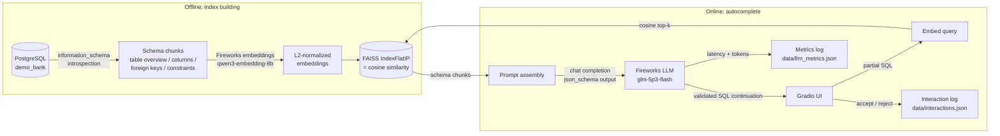

# SQL Query Builder

Schema-aware SQL autocomplete with tab-completion-style accept/reject, powered by
PostgreSQL schema introspection, FAISS vector retrieval, and Fireworks AI
serverless inference, with a Gradio UI.

## Overview

Writing SQL against an unfamiliar schema means constantly looking up table and
column names. This project explores a focused question: **does retrieving
relevant schema context improve LLM-based SQL autocomplete?**

You type a partial SQL query; the app embeds it, retrieves the most relevant
schema chunks (table overviews, column lists, foreign-key relationships) from a
FAISS index, and asks a Fireworks-hosted LLM for the next tokens — returned as
validated JSON via structured output. You can accept or reject each suggestion,
and every interaction and latency metric is logged for later analysis.

**Features**

- Partial-SQL completion with one-click accept/reject
- Optional schema-aware retrieval (toggleable, with adjustable `top_k`)
- Structured (JSON schema) model output, so completions parse reliably
- Per-request latency and token metrics, plus accept/reject interaction logging
- One-click export of metrics (JSON/CSV) and interactions (JSONL)

**Current limitations**

- Autocomplete only — no natural-language-to-SQL and no query execution
- Retrieval is purely semantic; rare or ambiguous column names can be missed
- The demo targets a single small PostgreSQL database (`demo_bank`)

## Architecture



**Code layout**

| Module | Responsibility |
|---|---|
| `src/config.py` | Model names and API endpoints (no I/O at import time) |
| `src/data_prep/build_schema_index.py` | PostgreSQL introspection → chunks → embeddings → FAISS index |
| `src/data_prep/data_prep.py` | Loader for pre-computed index artifacts |
| `src/search/vector_search.py` | Query embedding + FAISS search (lazy index loading) |
| `src/fireworks/inference.py` | Prompt assembly, structured-output completion, response parsing |
| `src/metrics.py` | Latency/token metrics and accept/reject interaction logging |
| `src/ui/theme.py` | Gradio theme and CSS |
| `src/app.py` | Gradio UI wiring |
| `tests/` | pytest suite (no credentials or database required) |

## Getting started

**Prerequisites**

- Python 3.11
- PostgreSQL (14+) running locally
- A [Fireworks AI](https://fireworks.ai) API key

**Setup**

```bash
# 1. Create the virtualenv, install dependencies, and create the demo database
make setup

# 2. Configure credentials
cp .env.example .env
#    edit .env: set FIREWORKS_API_KEY and your PostgreSQL user/password

# 3. Build the schema index (introspects demo_bank, embeds chunks, builds FAISS)
make index

# 4. Launch the app
make run
```

Then open http://127.0.0.1:7860.

`make setup` runs `scripts/setup/install_uv.sh` (installs [uv](https://docs.astral.sh/uv/)
if missing), creates `.venv` with Python 3.11, installs the package, and runs
`scripts/sql/generate_demo_bank.sql` to create and populate the `demo_bank`
database (50 fake customers, accounts, transactions, etc.).

**Troubleshooting**

| Symptom | Fix |
|---|---|
| `FAISS index not found ...` | Run `make index` (step 3) |
| `FIREWORKS_API_KEY not found` | Set it in `.env` or enter it in the UI's API-key field |
| `Error connecting to database` | Check PostgreSQL is running (`pg_isready`) and `PG*` values in `.env` |
| `LLM model not found` | The model id is unavailable on your Fireworks account; pick another from the dropdown |
| `psql: command not found` | Install PostgreSQL (e.g. `brew install postgresql@16`) |

Non-default database credentials can be passed inline:
`PGUSER=myuser PGPASSWORD=mypass make install`

## Usage

1. Paste your Fireworks API key and pick a model (default: `glm-5p3-flash`).
2. Type or click an example partial query, e.g.:
   - `-- get customer info for user 1` + `SELECT * FROM cus`
   - `SELECT account_type, SUM(current_balance) FROM accounts GROUP BY `
   - `SELECT t.transaction_id, c.full_name FROM transactions t JOIN `
3. Press **Get Autocomplete**. The suggestion appears in the middle column;
   retrieved schema chunks (with cosine scores) appear on the right.
4. Press **Yes, Apply** to append the completion to your query, or
   **No, Don't Apply** — either way the interaction is logged.
5. Toggle **Use Schema Retrieval** off to compare completion quality without
   schema context; adjust **Top K** (1–20) to change how many chunks are used.
6. Use the export buttons to download performance metrics (JSON) or
   interaction logs (JSONL) from `data/`.

## Technical design

**Why embeddings + FAISS?** The schema is small (23 chunks for `demo_bank`),
so a flat inner-product index (`IndexFlatIP`) gives exact cosine search in
microseconds with zero tuning. Both stored embeddings and query vectors are
L2-normalized, which makes inner product equivalent to cosine similarity.

**How schema is chunked.** Each table produces up to five chunk types: a table
overview (row count, keys), a column listing, foreign-key relationships,
constraints/indexes, and one chunk per cross-table relationship. This keeps
chunks small and topically focused, so top-k retrieval can mix column details
from one table with relationship facts from another.

**How structured output is enforced.** Completions use Fireworks'
`response_format: json_schema` with a Pydantic model (`SqlCompletion`), and the
JSON schema is also inlined into the system prompt. Parsing falls back to
regex extraction for models that wrap output in reasoning tags.

**Latency tradeoffs.** Retrieval adds one embedding API round-trip
(~100–300 ms) before generation. Metrics distinguish client-observed
end-to-end latency from server-reported time-to-first-token (read from the
`fireworks-server-time-to-first-token` header, in seconds); when the header is
absent, TTFT is recorded as `null` rather than estimated.

**Known gaps.** Semantic retrieval can miss relevant tables for multi-table
queries with generic phrasing; there is no SQL validation or execution; and
completion quality is evaluated only anecdotally via accept/reject rates.

## Future directions (not implemented)

- Natural-language-to-SQL with an agent runtime
- SQL validation, read-only execution, and error-correction loops
- Foreign-key-aware multi-table retrieval (expand results along FK graph)
- Hybrid keyword (BM25) + semantic retrieval
- Schema-context caching for lower-latency autocomplete
- Broader quality/latency/cost evaluations across models
- Fine-tuning a specialized SQL completion model on accepted interactions
- Speculative decoding where generation latency justifies it
- Improved collection and curation of user feedback

## Development

```bash
make test   # run the pytest suite (no credentials or database needed)
make clean  # remove venv and caches
```
